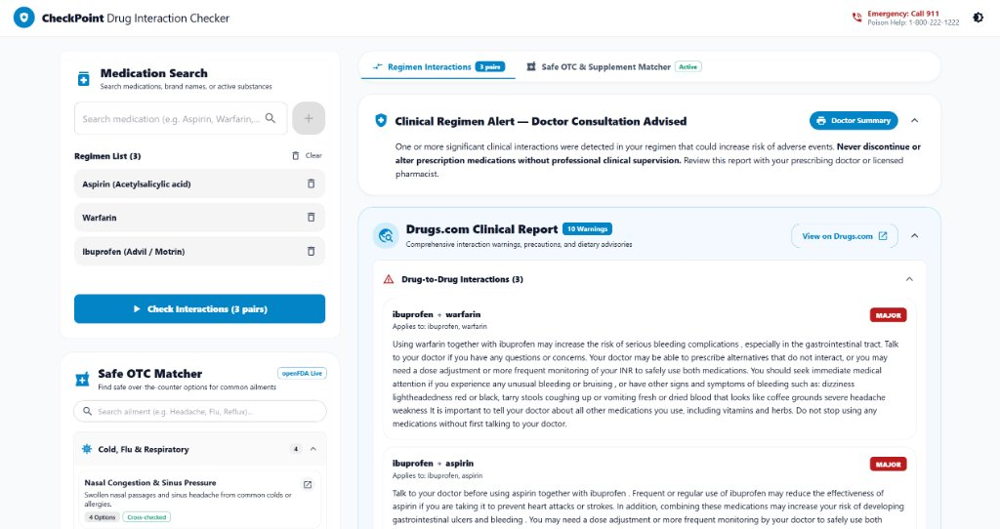
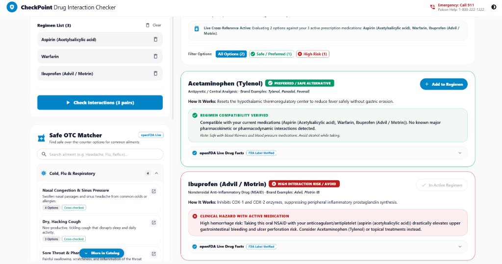

# CheckPoint — Drug Interaction Checker
### Keytos Hack 2026 — Track 02: Health Quest: Build for a Healthier Tomorrow

CheckPoint is a medication safety and drug interaction platform built with React, TypeScript, and Material UI. It evaluates multi-drug regimens, cross-references over-the-counter (OTC) options against active prescriptions, screens dietary contraindications, and generates physician consultation reports.

---

## Screenshots

### Regimen Interaction Analysis


### Safe OTC and Supplement Matcher


---

## Features

### Multi-Drug Regimen Evaluation (N >= 2)
- Evaluates pairwise interactions across all combinations ($\binom{N}{2} = \frac{N(N-1)}{2}$) for prescription drugs, OTC medications, and supplements.
- Live clinical interaction reports powered by Drugs.com via a Scrapling backend, with fallback to internal clinical rules and RxCheck API.
- Severity stratification across Major, Moderate, and Minor risk levels with clinical mechanism details and management guidance.

### Safe OTC and Supplement Matcher
- Real-time cross-referencing of OTC treatments for common ailments (respiratory, pain, gastrointestinal, allergy, sleep) against active prescriptions.
- Integration with openFDA for live drug labeling and facts.
- Risk classification: flags contraindicated medications (High Risk / Avoid) and identifies compatible alternatives (Safe / Preferred Alternative).

### Dietary and Lifestyle Screening
- Screens regimens against food and nutrient interactions, including grapefruit juice, calcium/dairy products, caffeine, tyramine-rich foods, and high potassium intake.

### Symptom Assessment and Triage
- Correlates user-reported symptoms with active medication adverse-effect profiles.
- Highlights emergency indicators (e.g., internal bleeding signs with anticoagulants, serotonin syndrome, respiratory depression).

### Clinician Consultation Summary and PDF Export
- Generates structured clinical summaries and downloadable PDF checklists (via jsPDF) for medical visits.

### Resilient Architecture and Caching
- Automatic key rotation across fallback API keys (`VITE_RXCHECK_API_KEYS`) upon HTTP 429 or quota depletion.
- Client-side `localStorage` caching to eliminate redundant API requests.
- Python scraper backend managed automatically by the Vite development server with restart capability.

---

## Tech Stack

- **Frontend**: React 19, TypeScript, Vite
- **UI Components**: Material UI (MUI v9), Emotion, MUI Icons
- **PDF Generation**: jsPDF
- **Backend Services**: Python, Scrapling, Starlette, Uvicorn, BeautifulSoup4
- **External Data**: Drugs.com, openFDA API, RxCheck API

---

## Getting Started

### Prerequisites
- Node.js (v18+)
- Python 3.10+
- npm

### 1. Clone Repository
```bash
git clone https://github.com/secondjb/keytos-hackathon-2026.git
cd keytos-hackathon-2026
```

### 2. Install Dependencies

Frontend:
```bash
npm install
```

Backend:
```bash
pip install scrapling starlette uvicorn beautifulsoup4
```

### 3. Configure Environment Variables
Copy `.env.example` to `.env`:
```bash
cp .env.example .env
```

Configure API keys in `.env` (optional when using the scraper backend):
```env
VITE_RXCHECK_API_KEY=your_key_here
VITE_RXCHECK_API_KEYS=key_1,key_2,key_3
VITE_RXCHECK_BASE_URL=https://api.rxcheck.dev/v1
```

### 4. Run Development Server
```bash
npm run dev
```
Vite automatically starts the Python scraper backend on port 5001.

### 5. Build for Production
```bash
npm run build
```

---

## Clinical Disclaimer

CheckPoint is an informational decision-support tool and does not provide medical diagnoses or replace professional clinical judgment. Always consult a licensed physician or pharmacist before starting, stopping, or altering any medication regimen.
